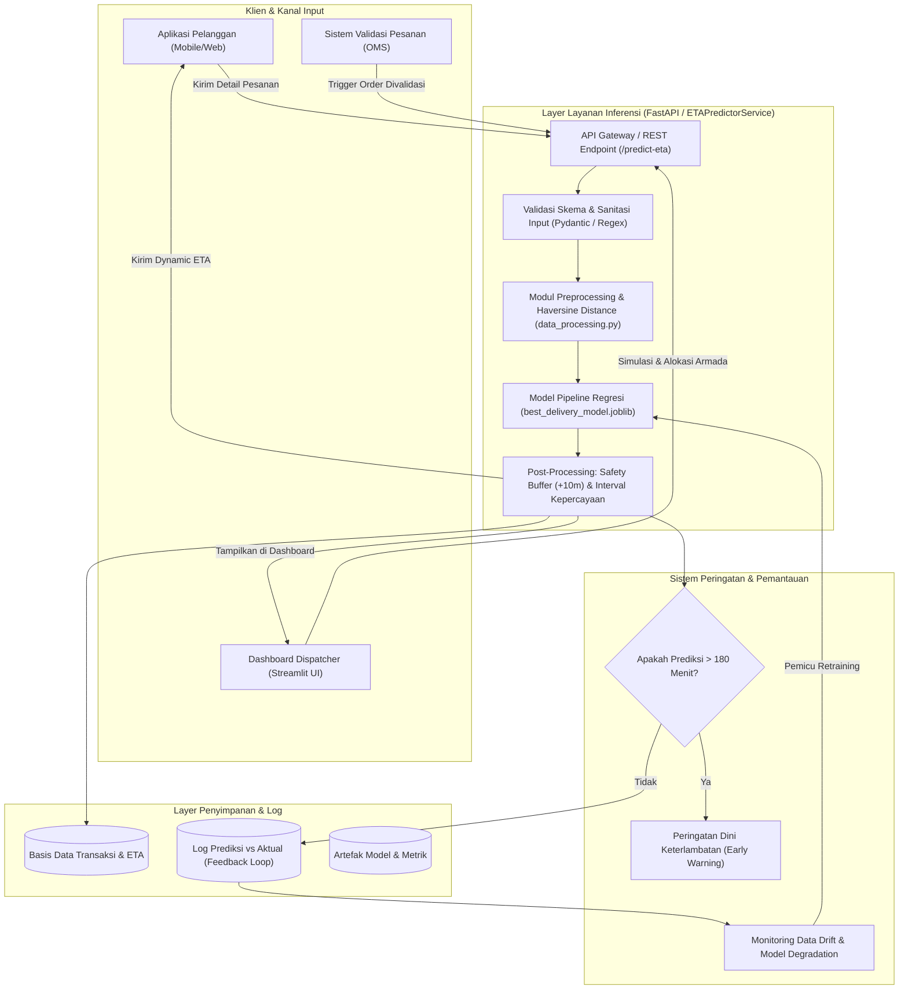

# RENCANA DEPLOYMENT SISTEM PREDIKSI WAKTU PENGIRIMAN LOGISTIK LAST-MILE
## CRISP-DM Fase 6: Deployment yang Proporsional dengan Konteks

* **Judul Proyek:** Prediksi Durasi Pengiriman Pesanan E-Commerce untuk Optimalisasi Estimasi Waktu Tiba Menggunakan Regresi Machine Learning pada Data Operasional Amazon Delivery
* **Institusi:** Program Studi Informatika, Jurusan Informatika, Fakultas Teknik Industri, Universitas Pembangunan Nasional "Veteran" Yogyakarta
* **Tahun:** 2026
* **Tim Penyusun:** Zaka Ahmad Ghofari, Prajna Satria Aji Dharma, Anugrah Rajendra Hafizuddin, Rifki Zakaria Yahya
* **Dosen Pengampu:** Dhimas Arief Dharmawan

---

## 1. Konteks dan Rasionalitas Pendekatan "Proporsional"

Dalam siklus hidup proyek sains data (CRISP-DM), tahap *Deployment* tidak selalu berarti menggelar infrastruktur berskala *hyper-scale* (seperti kluster Kubernetes multi-region atau streaming Kafka) yang berlebihan (*over-engineered*) terhadap kebutuhan operasional nyata.

Berdasarkan analisis pada tahap **Business Understanding** dan **Data Understanding**:
1. **Skala Transaksi:** Dataset berukuran 43.739 transaksi dengan pola per jam yang dapat diproses secara ringan (*lightweight*) pada latensi di bawah 20 milidetik per inferensi.
2. **Kebutuhan Bisnis Utama (Primary Use Case):**
   * *Dynamic ETA*: Perhitungan durasi pengiriman secara instan saat pelanggan melakukan *checkout* atau sistem memvalidasi pesanan.
   * *Early Warning Delay System*: Deteksi dini pesanan berisiko tinggi (> 180 menit) agar dispatcher dan staf *customer service* dapat mengambil tindakan mitigasi proaktif.
   * *Smart Dispatching*: Rekomendasi moda kendaraan dan alokasi armada berdasarkan estimasi durasi dan kepadatan lalu lintas.
3. **Konteks Implementasi:** Arsitektur yang proporsional mengadopsi model **Hybrid Serving**:
   * **Online Real-Time REST Microservice:** Menjawab kebutuhan kalkulasi ETA instan pada aplikasi seluler pelanggan.
   * **Interactive Dispatcher UI (Streamlit):** Memberikan kendali visual harian kepada tim operasional dan dispatcher gudang.
   * **Scheduled Batch Pipeline:** Skrip terjadwal harian/mingguan untuk evaluasi SLA, audit integritas data, dan deteksi *drift*.

---

## 2. Arsitektur Sistem Deployment



---

## 3. Spesifikasi Komponen Sistem

### 3.1. Artefak Model & Pipeline Serialisasi
* **Format Serialisasi:** `joblib` terkompresi (`best_delivery_model.joblib`).
* **Kandungan Pipeline:**
  1. *ColumnTransformer* (`preprocessor`): Menjalankan One-Hot Encoding pada variabel nominal (`Weather`, `Traffic`, `Vehicle`, `Area`, `Category`) dan standardisasi skala numerik (`Distance_km`, `Pickup_Delay_min`, `Order_Hour`, `Agent_Age`, `Agent_Rating`).
  2. *Estimator Regresi*: `HistGradientBoostingRegressor` / `RandomForestRegressor` yang telah dilatih pada data historis terurut secara temporal (menghindari *future data leakage*).
* **Metadata & Versi:** Seluruh parameter, versi *library*, metrik evaluasi (`MAE: 17.71`, `R²: 0.810`, `Acc ±30m: 82.96%`, `Recall >180m: 72.72%`) disimpan secara terstruktur di `Scripts/models/evaluation_metrics.json`.

### 3.2. Penanganan Fitur Saat Inferensi Real-Time
Pada saat pesanan baru masuk dari aplikasi pelanggan:
* **Jarak Geodesik (Haversine):** Dihitung secara deterministik dalam milidetik dari koordinat lintang-bujur gerai toko dan alamat tujuan. Koordinat bertanda minus dinormalisasi secara otomatis ke nilai absolut.
* **Koreksi Waktu:** Waktu lintas hari (*cross-midnight*) diperbaiki menggunakan *offset* modulo 1440 menit bila waktu penjemputan melewati pergantian hari kalender.
* **Pembersihan String:** Spasi berlebih (*trailing whitespace*) dan variasi saltik seperti `Metropolitian` distandardisasi menjadi bentuk baku sebelum dimasukkan ke *pipeline*.

### 3.3. Penambahan Buffer Keselamatan (*Safety Buffer*)
Sebagaimana dirumuskan dalam Bab 1.7 (Risiko & Etika), sistem tidak langsung menampilkan estimasi murni dari model (*raw ETA*) ke kurir maupun pelanggan:
$$\text{Janji ETA ke Pelanggan} = \widehat{y}_{\text{prediksi}} + \text{Buffer Keselamatan (10 Menit)}$$
*Fungsi:* Menghilangkan tekanan psikologis berlebih pada kurir pengantar, mencegah pelanggaran rambu lalu lintas akibat target yang tidak realistis, dan menjaga tingkat kepuasan pelanggan tetap tinggi ketika menghadapi hambatan minor di jalan.

---

## 4. Rencana Pemantauan & Pemeliharaan (*Monitoring & Retraining*)

### 4.1. Pemantauan Penyimpangan Data (*Data & Concept Drift*)
Model machine learning logistik rentan terhadap pergeseran kondisi lingkungan. Pemantauan periodik mencakup:
1. **Pergeseran Fitur Cuaca & Musiman (*Weather Drift*):**
   * Peringatan aktif jika proporsi cuaca ekstrem (`Stormy`, `Sandstorms`) naik > 20% dibandingkan distribusi data latih.
2. **Pergeseran Kepadatan Lalu Lintas (*Traffic Drift*):**
   * Pemantauan rasio jam sibuk (`Jam` & `High`) saat hari libur nasional atau perayaan keagamaan.
3. **Penyimpangan Spasial (*Spatial Drift*):**
   * Deteksi ekspansi ke area baru (misal: bertambahnya pesanan dari tipologi `Semi-Urban` atau `Other`).

### 4.2. Pemantauan Penurunan Kinerja (*Model Degradation Tracking*)
Sistem mencatat waktu konfirmasi serah terima barang aktual ketika kurir menekan tombol "Pesanan Selesai" pada aplikasi kurir:
* **Metrik Harian:** Menghitung MAE rata-rata harian:
  $$\text{MAE}_{\text{harian}} = \frac{1}{N}\sum_{i=1}^N \left| \text{Delivery\_Time}_{\text{aktual}} - \widehat{\text{Delivery\_Time}} \right|$$
* **Ambang Batas Peringatan (*Alert Threshold*):**
  * *Status Kuning (Warning):* Jika MAE mingguan naik > 15% di atas batas dasar (misal: MAE > 21 menit).
  * *Status Merah (Critical):* Jika akurasi janji tiba $\pm 30$ menit turun di bawah 75%, atau MAE segmen wilayah tertentu melebihi 1,5× rata-rata keseluruhan.

### 4.3. Kebijakan Retraining Terjadwal & Terpicu
* **Jadwal Berkala:** Pelatihan ulang model (*retraining*) dilakukan setiap 2 minggu sekali dengan menyertakan *sliding window* data 60 hari terakhir.
* **Pemicu Otomatis (*Trigger-based Retraining*):** Dijalankan seketika apabila terjadi perubahan regulasi batas kecepatan jalan, ekspansi rute baru, atau tercapainya *status merah* pemantauan MAE.

---

## 5. Kepatuhan Hukum, Privasi Data, dan Safeguard Etika

| Isu Etika / Hukum | Potensi Risiko | Mitigasi Operasional pada Deployment |
| :--- | :--- | :--- |
| **UU No. 27 Tahun 2022 (PDP)** | Paparan data lokasi sensitif (koordinat tepat rumah pelanggan dan toko). | Koordinat mentah hanya diproses di memori (*in-memory*) untuk kalkulasi jarak geodesik dan segera dianomalisasi. Log penyimpanan hanya menyimpan jarak agregat (`Distance_km`) dan tingkat distrik/area. |
| **Perlindungan Pekerja Anak** | Data historis mencatat `Agent_Age` 15 tahun (bertentangan dengan UU Ketenagakerjaan). | Sistem deployment menerapkan filter validasi tegas: akun kurir dengan usia < 18 tahun **diblokir secara otomatis** dari penugasan paket. |
| **Keadilan Penilaian Kurir** | Diskriminasi algoritmis berdasarkan usia atau rating kurir masa lalu. | Fitur `Agent_Age` dan `Agent_Rating` dinonaktifkan dalam penentuan penalti kinerja kurir; hanya digunakan sebagai faktor kalibrasi agregat internal. |
| **Kesejahteraan & Keselamatan Kurir** | Target waktu terlalu ketat memicu kurir ngebut dan berisiko kecelakaan. | Penerapan *Safety Buffer* wajib (+10 menit) dan toleransi keterlambatan tanpa sanksi finansial pada kondisi cuaca badai (`Stormy`) atau macet parah (`Jam`). |

---

## 6. Petunjuk Eksekusi Komponen Deployment

### 6.1. Menjalankan Skrip Inferensi CLI / Uji Coba Cepat
Untuk menguji coba inferensi modul prediksi mandiri:
```bash
python Scripts/predict.py
```

### 6.2. Menjalankan Dashboard Antarmuka Pengiriman (Streamlit)
Untuk menjalankan antarmuka web interaktif yang siap disimulasikan oleh dispatcher:
```bash
streamlit run Scripts/app.py
```

### 6.3. Menjalankan Pelatihan Ulang & Evaluasi Model
Untuk melatih ulang model dengan konfigurasi termutakhir di `Scripts/config.yaml`:
```bash
python Scripts/model_pipeline.py --train
```

